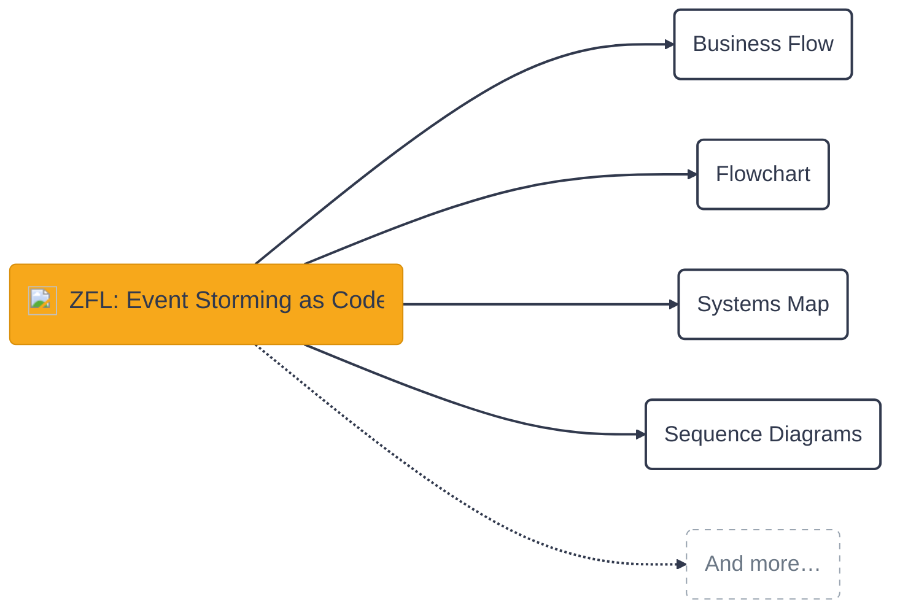
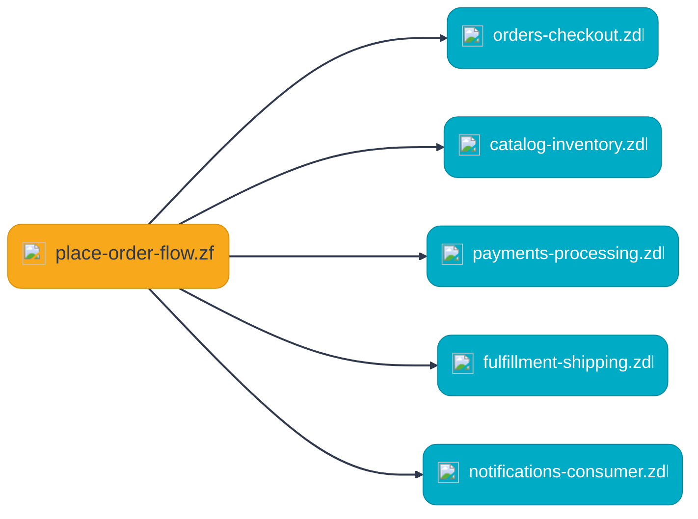
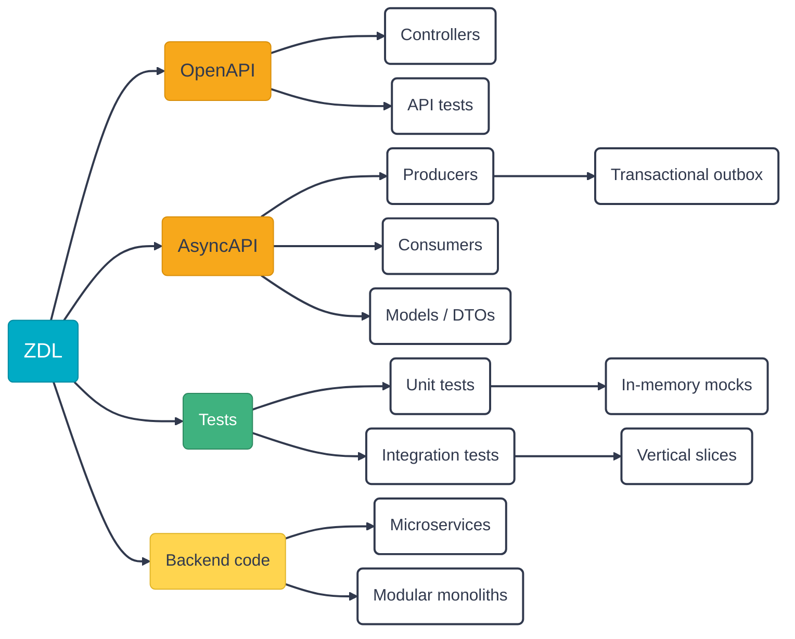

<!-- DRAFT · Human in the Loop part. "Away from Keyboard" part goes after the last slide. -->

<!-- Published JUG title -->

<p style="font-size:26px;line-height:1.2;text-align:center;margin:0">AI-Assisted Domain Driven Design</p>
<p style="font-size:34px;line-height:1.2;font-weight:700;text-align:center;margin-top:16px">From Event Storming to an Event-Driven modular monolith with Kotlin & Spring Boot</p>

<p style="position:absolute;left:24px;bottom:12px;font-size:18px;color:#6b7785;margin:0">Ivan Garcia Sainz-Aja</p>
<p style="position:absolute;right:24px;bottom:12px;font-size:18px;color:#6b7785;margin:0">Coruña JUG · 19 November 2026</p>

---
layout: section
title: 'Software Engineering in 2026'
---

<ul class="opening-list">
  <li v-click="1"><ph-code-bold class="ic code" />Generating <span class="code">code</span> becomes cheap</li>
  <li v-click="2"><ph-magnifying-glass-bold class="ic verify" /><span class="verify">Verifying</span> is the hard part
    <ul>
      <li v-click="3" class="spec"><ph-file-text-bold class="ic" />Approving the spec</li>
      <li v-click="4"><ph-flask-bold class="ic" />Testing the result</li>
      <li v-click="5" class="prove"><ph-seal-check-bold class="ic" />… and proving it</li>
    </ul>
  </li>
</ul>

<!-- The question this talk answers. Don't give the answer yet. Spec = core of the talk (DDD as code). Testing = classic tests (validation, contract, unit, integration). Proving = we point towards formal verification, not a full answer. Answers revealed in the recap slide at the end. -->

<style>
.opening-list { list-style: none; margin: 0; padding: 0; text-align: left; }
.opening-list li { font-size: 40px !important; font-weight: 700; line-height: 1.3 !important; margin: 0.5em 0 !important; color: #31394d; }
.opening-list .ic { display: inline-block; width: 1.1em; height: 1.1em; margin-right: 0.5em; vertical-align: -0.2em; color: #6b7785; }
.opening-list ul { list-style: none; margin: 0.5em 0 0 1.6em; padding: 0; }
.opening-list ul li { font-size: 34px !important; font-weight: 700; margin: 0.5em 0 !important; }
.opening-list ul li.spec { font-size: 38px !important; color: #00abc5; }
.opening-list ul li.spec .ic { color: #00abc5; }
.opening-list ul li.prove { font-style: italic; color: #6b7785; }
.opening-list .code { color: #00abc5; }
.opening-list .verify { color: #f7a81b; }
</style>

---
layout: section
title: 'Software Engineering in 2026'
---

<h1 style="font-size:64px !important;text-align:center">Spec Driven Development</h1>

---
layout: section
title: 'Software Engineering in 2026'
---

<h1 style="font-size:64px !important;text-align:center">The problem</h1>

---
layout: default
title: 'Markdown is the bottleneck'
---

<div style="margin:-34px -55px -38px;height:457px;box-sizing:border-box;padding:10px;display:flex;align-items:center;justify-content:center">
<Shot src="/Markdown-Mayhem_%20LLM-Paper-Flood.png" todo="LLM flooding a developer with Markdown" h="437px" />
</div>

<!-- Only the problem: LLMs generate Markdown faster than anyone can read it. The developer drowns. Leads into "Markdown is the bottleneck". -->

---
layout: default
title: 'The problem: Markdown is the bottleneck'
hide: true
---

<div style="margin:-34px -55px -38px;height:457px;box-sizing:border-box;padding:10px;display:flex;align-items:center;justify-content:center">
<Shot src="/markdown-is-the-bottleneck-featured.webp" todo="Markdown is the bottleneck (blog featured image)" h="437px" />
</div>

<!-- The problem. LLMs write Markdown faster than any human can read it. Nobody reads it all; decisions slip in as "approved". Reading Markdown is the bottleneck. -->

---
layout: section
title: ''
---

<h1 style="font-size:64px !important;text-align:center">The proposal</h1>

---
layout: section
title: 'The proposal'
---

<h1 class="ddd-title">Domain Driven Design</h1>

<h1 v-click="1" class="ddd-ascode">as code</h1>

<!-- The proposal: DDD. Click: as code. Next slide shows what "as code" means. -->

<style>
.ddd-title { font-size: 48px !important; }
.ddd-ascode { color: #00abc5 !important; font-size: 76px !important; margin-top: -4px !important; }
</style>

---
layout: section
title: 'Domain Driven Design'
titleAccent: ' as code'
---

<div class="p2-row">


<div v-click="2" class="p2-models">
<span class="p2-arrow">→</span>
<div class="p2-files">
<div class="p2-file zfl">
<b>place-order.zfl <small>Process Level</small></b>

```zfl
when OrderCreated do authorizePayment {
    service PaymentsProcessing
    emits PaymentAuthorized
    emits PaymentDeclined
}
```

</div>
<div class="p2-file zdl">
<b>payments-processing.zdl <small>Design Level</small></b>

```zfl
service PaymentsProcessingService {
  @asyncapi(channel: "order-created")
  authorizePayment(AuthorizePaymentInput)
    withEvents [PaymentAuthorized |
                         PaymentDeclined]
}
```

</div>
</div>
</div>

</div>

<!-- Variant B: ZDL shows a service (command + events) instead of the aggregate, to connect with Event Storming. What "as code" means. Clicks: 1 the blueprints (Event Storming, state machines, class diagrams), 2 they become real code: ZFL (process level) + ZDL (design level). -->

<style>
.p2-row { display: flex; align-items: center; justify-content: center; gap: 28px; }
.p2-blueprints { height: 235px; width: auto; flex: none; transform: rotate(-9deg); }
.p2-models { display: flex; align-items: center; gap: 18px; }
.p2-arrow { font-size: 48px; color: #31394d; }
.p2-files { display: flex; flex-direction: column; gap: 12px; text-align: left; }
.p2-file { border-left: 6px solid #31394d; border-radius: 6px; box-shadow: 0 4px 14px rgba(49,57,77,.18); background: #fff; padding: 6px 10px 2px; }
.p2-file.zfl { border-left-color: #f7a81b; }
.p2-file.zdl { border-left-color: #00abc5; }
.p2-file b { display: block; font-size: 16px; color: #31394d; margin-bottom: 4px; }
.p2-file b small { font-weight: 400; color: #6b7785; margin-left: 8px; }
.p2-file .slidev-code { margin: 0 !important; --slidev-code-font-size: 15px; --slidev-code-line-height: 1.4; }
</style>

---
layout: two-columns
title: 'Spec-Driven Development: Two Loops'
---

::left::

<div v-click="1">

### Human in the Loop

<Shot src="/two-loops-human-in-the-loop-featured.png" todo="HITL loop image" h="260px" />

DDD → models you can read and approve

</div>

::right::

<div v-click.hide="2">

### Away From Keyboard

<Shot src="/two-loops-afk-featured.png" todo="AFK loop image" h="260px" />

Agents implement the approved models

</div>

<!--
Two loops. AFK first: fully agentic, orchestrator + subagents, only after the human approves the models.
Then HITL: discovery + modeling (Event Storming, ZFL, ZDL), human reviews projections.
Today we focus on HITL. Everything until "Away from Keyboard" section is the HITL loop.
-->

---
layout: about-me
title: ''
---


<div class="iv-about-copy">
  <h1 class="iv-about-name">Ivan Garcia Sainz-Aja</h1>
  <p class="iv-about-handle">@ivangsa · ivangsa.com</p>
  <ul class="iv-about-list">
    <li>Creator and maintainer of <strong>ZenWave360</strong></li>
    <li>AsyncAPI <strong>TSC Member</strong> and <strong>Ambassador</strong></li>
    <li>Maintainer of <strong>VSCode Preview Extension</strong> and <strong>Kafka Bindings</strong></li>
    <li>Built <strong>Arcadia Editions</strong> to show DDD as code end to end</li>
  </ul>
</div>

<!-- Why me: ZDL in production since 2023, ZFL this year. Arcadia Editions: why I built it. -->

---
layout: cover
title: 'Arcadia Editions'
---

<Shot src="/arcadia-editions-logo.png" todo="Arcadia Editions logo (centered)"" />

---
layout: default
title: 'Arcadia Editions @ GitHub'
---

<p style="position:absolute;right:24px;bottom:12px;font-size:20px;color:#6b7785;margin:0">github.com/arcadia-editions</p>

<div style="margin:-22px -55px 0">
<Shot src="/arcadia-editions-github-screenshot.png" todo="Screenshot: Arcadia Editions GitHub org main page" h="405px" />
</div>

---
layout: section
title: 'Arcadia Editions'
---


# Discovering the domain

---
layout: default
title: 'Three levels of Event Storming'
---

<div style="margin:-10px -55px 0">
<Shot src="/event-storming-three-levels-notebook.webp" todo="Event Storming three levels (notebook)" h="405px" />
</div>

---
layout: default
title: 'Arcadia Editions in Miro'
---

<div style="margin:20px -55px 10px">
<Shot src="/003-event-storming-arcadia-editions.jpg" todo="First Miro Event Storming" />
</div>

---
layout: default
title: 'ZDL: Design Level Event Storming as Code'
---

<div style="margin:-32px -55px -38px">
<Shot src="/EventStorming-ZDL-Mapping.png" todo="2023 image: Event Storming design level mapped to ZDL" h="455px" />
</div>

<!-- ZDL: Design Level as code. Built 2023, in production projects for 4 years. Gave me the experience building DSLs, parsers and IDE editors (highlighting, autocomplete, preview). -->

---
layout: default
title: 'ZFL: Process Level Event Storming as Code'
---

<div style="margin:-34px -55px -38px;height:457px;box-sizing:border-box;padding:10px;display:flex;align-items:center;justify-content:center">
<Shot src="/event-storming-zfl-eventflow-and-systems.webp" todo="ZFL editor + event flow + systems" h="437px" />
</div>

<!-- ZFL: Process Level as code. Built this year on top of the ZDL experience. Delivers what it promises so far, but not production-proven yet. -->

---
layout: section
title: 'Arcadia Editions'
---

# Place Order Business Flow

---
layout: default
title: 'Event Storming: Events are business Facts'
---

<div style="margin:-34px -55px -38px;height:457px;display:flex;align-items:center;justify-content:center">
<Shot src="/eventstorming-events-sequence.jpg" todo="Event Storming: Events are business Facts" h="445px" />
</div>

---
layout: default
title: 'Event Storming: Commands trigger Events'
---

<div style="margin:-34px -55px -38px;height:457px;display:flex;align-items:center;justify-content:center">
<Shot src="/eventstorming-events-commands.jpg" todo="Event Storming: Commands trigger Events" h="445px" />
</div>

---
layout: default
title: 'Event Storming: Policies are Business Rules'
---

<div style="margin:-34px -55px -38px;height:457px;display:flex;align-items:center;justify-content:center">
<Shot src="/eventstorming-events-commands-policies.jpg" todo="Event Storming: Policies are Business Rules" h="445px" />
</div>

<!-- Optional: hotspots version in public/eventstorming-events-commands-policies-hotspots.jpg -->

---
layout: section
title: 'ZFL'
---

# ZFL: Process Level Event Storming as Code

---
layout: default
title: 'ZFL: Building Blocks'
---

````md magic-move {lines: true}
```zfl
// 1. a business policy looks like
//      when <event> do <command>
when OrderCreated do authorizePayment {

}
```

```zfl
// 2. what a command produces: emits
when OrderCreated do authorizePayment {
    emits PaymentAuthorized
    emits PaymentDeclined
    emits PaymentFailed
}
```

```zfl
// 2b. sync calls: call + response
when StartOrderCheckout do startOrderCheckout {
    call reserveStock
    on StockReservedResult emits OrderCreated
    on StockUnavailableResult emits StockUnavailable
}

do reserveStock {
    response StockReservedResult
    response StockUnavailableResult
}
```

```zfl
// 3. outcomes: name each branch
when OrderCreated do authorizePayment {
    @outcome(authorized)
    emits PaymentAuthorized
    @outcome(declined)
    emits PaymentDeclined
    @failure @outcome(failed)
    emits PaymentFailed
}
```

```zfl
// 4. systems: who owns the command
when OrderCreated do authorizePayment {
    service PaymentsProcessing.PaymentsProcessingService
    @outcome(authorized)
    emits PaymentAuthorized
    @outcome(declined)
    emits PaymentDeclined
    @failure @outcome(failed)
    emits PaymentFailed
}
```

```zfl {3}
// 4. systems: who owns the command
when OrderCreated do authorizePayment {
    service PaymentsProcessing.PaymentsProcessingService
    @outcome(authorized)
    emits PaymentAuthorized
    @outcome(declined)
    emits PaymentDeclined
    @failure @outcome(failed)
    emits PaymentFailed
}
```
````

---
layout: default
title: 'ZFL: The systems'
---

```zfl
systems {
    @zdl("../payments-processing-api/domain-model.zdl")
    PaymentsProcessing {
        service PaymentsProcessingService {
            commands: authorizePayment, retryPayment,
                    capturePayment, voidPayment
        }
    }
    @zdl("../catalog-inventory-api/domain-model.zdl")
    CatalogInventory { ... }
}
```


---
layout: default
title: 'ZFL: EventStorming as Code'
---

<div style="display:flex;justify-content:center">



</div>

---
layout: default
title: 'ZFL Projections - Event Flow'
---

<div style="margin:-34px -55px -38px;height:457px;box-sizing:border-box;padding:10px;display:flex;align-items:center;justify-content:center">
<Shot src="/zfl-eventflow-to-the-side.png" todo="ZDL: Event Flow" h="437px" />
</div>

---
layout: default
title: 'ZFL Projections - Systems'
---

<div style="margin:-34px -55px -38px;height:457px;box-sizing:border-box;padding:10px;display:flex;align-items:center;justify-content:center">
<Shot src="/zfl-systems.png" todo="ZFL Systems" h="437px" />
</div>

---
layout: default
title: 'ZFL Projections - Event Flow with System Lanes'
---

<div style="margin:-34px -55px -38px;height:457px;box-sizing:border-box;padding:10px;display:flex;align-items:center;justify-content:center">
<Shot src="/eventflow-lanes.png" todo="Event Flow with Lanes" h="437px" />
</div>

---
layout: default
title: 'ZFL Projections - Sequence Diagrams'
---

<div style="margin:-34px -55px -38px;height:457px;box-sizing:border-box;padding:10px;display:flex;align-items:center;justify-content:center">
<Shot src="/zfl-sequence-diagrams-to-the-side.png" todo="ZFL: Sequence diagrams" h="437px" />
</div>

---
layout: section
title: 'Zoom in'
---

<div class="zoom-stage">
  <div class="zoom-word">ZFL to ZDLs</div>
  <div v-click class="zoom-glass">
    
  </div>
</div>

<!-- Zoom from the business flow (ZFL) into each bounded context (ZDLs). -->

<style>
.zoom-stage { position: relative; width: 860px; height: 380px; margin: -20px auto 0; }
.zoom-word {
  position: absolute; left: 0; right: 0; top: 50%; transform: translateY(-50%);
  text-align: center; font-size: 110px; font-weight: 700; color: #31394d; white-space: nowrap;
  z-index: 1;
}
.zoom-glass {
  position: absolute; width: 380px; height: 380px; left: 442px; top: 36px;
  transform: rotate(-20deg); /* more negative = more horizontal handle */
  z-index: 0; /* behind the letters once in place */
  /* z-index flips after the 0.9s move: glass enters in front, then goes behind */
  transition: transform 0.9s cubic-bezier(.2,.8,.2,1), opacity 0.6s ease, z-index 0s linear 0.9s;
}
.zoom-glass.slidev-vclick-hidden { opacity: 0 !important; transform: translate(220px, 80px) rotate(10deg) scale(.7); z-index: 2; }
.zoom-glass img { width: 100%; height: 100%; mix-blend-mode: multiply; }
</style>

---
layout: default
title: 'ZDL: Design Level Event Storming as Code'
---

<div style="margin:-32px -55px -38px">
<Shot src="/EventStorming-ZDL-Mapping.png" todo="2023 image: Event Storming design level mapped to ZDL" h="455px" />
</div>

---
layout: default
title: 'From ZFL: what we have to build'
---

<div style="margin:-34px -55px -38px;height:457px;box-sizing:border-box;padding:10px;display:flex;align-items:center;justify-content:center">
<Shot src="/zfl-systems.png" todo="ZFL Systems" h="437px" />
</div>

<!-- Same Systems projection, different question: from one ZFL we know which systems to build, and which commands and events each one implements. -->

---
layout: default
title: 'One business flow: many bounded contexts'
---

<div style="display:flex;justify-content:center">



</div>

---
layout: default
title: 'ZenWave SDD skills'
---

<p style="position:absolute;right:24px;bottom:12px;font-size:20px;color:#6b7785;margin:0">github.com/ZenWave360/zenwave-sdd</p>

<div style="margin:-22px -55px 0">
<Shot src="/zenwave-sdd-github.png" todo="Screenshot: skills repo in GitHub" h="400px" />
</div>

<!-- Not by hand: an AI skill in this repo reads the ZFL + the services to implement, and drafts one repo per system with a draft ZDL. Very complete draft; you still review it. -->

---
layout: section
title: 'Built to last'
---

# Code is getting cheaper.

---
layout: default
title: 'Built to last'
---

# What outlives the code?

<div style="height:300px;display:flex;align-items:center;justify-content:center">
  <ul class="outlives">
    <li v-click>Data</li>
    <li v-click>APIs</li>
    <li v-click>Events</li>
  </ul>
</div>

<style>
.outlives { list-style: none; margin: 0; padding: 0; text-align: left; }
.outlives li { display: flex; align-items: center; gap: 0.4em; font-size: 54px !important; font-weight: 700; line-height: 1.1 !important; margin: 0.18em 0 !important; color: #31394d; }
/* checkbox marker: cyan box with a check */
.outlives li::before {
  content: "✓"; flex: none; width: 1.4em; height: 1.4em; box-sizing: border-box;
  border: 0.14em solid #00abc5; border-radius: 0.2em;
  display: flex; align-items: center; justify-content: center;
  font-size: 0.57em; font-weight: 900; line-height: 1; color: #00abc5;
}
</style>

<!-- Agentic coding makes code cheap. Rewrite the app in a year. Data, APIs, events must last. -->

---
layout: default
title: 'ZDL captures what lasts'
class: code-sm
---

````md magic-move {lines: true}
```zfl
// Data: aggregate + state machine
@aggregate
@lifecycle(field: status, initial: CREATED)
entity Order {
    orderId String required unique
    status OrderStatus required
    totalAmount BigDecimal required
}
relationship OneToMany {
    Order{items} to OrderItem{order required}
}

enum OrderStatus { CREATED(1), CONFIRMED(2), CANCELLED(3) }
```

```zfl
// APIs: commands, REST endpoints, state transitions
@rest("/orders")
service OrdersCheckoutService for (Order) {

    @post("/start-checkout")
    @transition(to: CREATED)
    startOrderCheckout(StartOrderCheckoutInput) Order
        withEvents [OrderCreated | StockUnavailable]

    @get("/{id}")
    getOrder(id) Order?
}
```

```zfl
// Events: what we publish (AsyncAPI)
@asyncapi({ channel: "order-created-event-v1" })
event OrderCreated {
    orderId String
    customerId String
    paymentMethodId String
    amount BigDecimal
    currency String
}
```

```zfl
// Events: what we consume (AsyncAPI)
@rest("/orders")
service OrdersCheckoutService for (Order) {

    @asyncapi(api: PaymentsProcessingApi,
              channel: "payment-authorized-event-v1")
    @transition(from: CREATED, to: CONFIRMED)
    confirmOrder(ConfirmOrderInput) Order  withEvents OrderConfirmed
}
```

```zfl {5-6}
// Events: what we consume (AsyncAPI)
@rest("/orders")
service OrdersCheckoutService for (Order) {

    @asyncapi(api: PaymentsProcessingApi,
              channel: "payment-authorized-event-v1")
    @transition(from: CREATED, to: CONFIRMED)
    confirmOrder(ConfirmOrderInput) Order  withEvents OrderConfirmed
}
```
````

<!-- Source: orders-checkout-api/domain-model.zdl (trimmed). Data + state machine, APIs, events. -->

---
layout: default
title: 'Connected Graph: ZFL ↔ ZDL'
---

<div class="link-panes">
<div class="link-pane zfl">
<b>place-order-flow.zfl</b>
<pre>systems {
  <span v-mark="{ at: 1, type: 'box', color: '#f7a81b' }">@zdl("catalog-inventory-api/domain-model.zdl")</span>
  CatalogInventory { ... }
}
&nbsp;
@compensates(reserveStock)
when <span v-mark="{ at: 3, type: 'underline', color: '#00abc5' }">PaymentDeclined</span>, ...
  do <span v-mark="{ at: 2, type: 'circle', color: '#3fb27f' }">releaseStock</span> {
    service CatalogInventory.InventoryService
    emits <span v-mark="{ at: 4, type: 'underline', color: '#9b6bd6' }">StockReleased</span>
}</pre>
</div>
<div class="link-pane zdl">
<b v-mark="{ at: 1, type: 'box', color: '#f7a81b' }">catalog-inventory-api/domain-model.zdl</b>
<pre>service InventoryService for (StockReservation) {
&nbsp;
  @asyncapi(api: PaymentsProcessingApi,
    channel: "<span v-mark="{ at: 3, type: 'underline', color: '#00abc5' }">payment-declined-event-v1</span>")
  @transition(from: [RESERVED, CONFIRMED],
              to: RELEASED)
  <span v-mark="{ at: 2, type: 'circle', color: '#3fb27f' }">releaseStock</span>(ReleaseStockInput)
    withEvents <span v-mark="{ at: 4, type: 'underline', color: '#9b6bd6' }">StockReleased</span>
}</pre>
</div>
</div>

<p v-click="5" class="link-verdict">ZFL + ZDLs → one connected graph, deterministically parseable.</p>

<!-- Every name in the ZFL points to something real in a ZDL. 1: system → ZDL file. 2: command → service method (with its state transition). 3: event consumed → AsyncAPI channel. 4: event emitted → ZDL event. Not a drawing: links you can follow, by parser or by LLM. -->

<style>
.link-panes { display: flex; gap: 20px; margin-top: -6px; }
.link-pane { flex: 1; display: flex; flex-direction: column; gap: 6px; padding: 10px 14px; background: #fff; border: 2px solid #31394d; border-top-width: 8px; border-radius: 8px; }
.link-pane.zfl { border-top-color: #f7a81b; }
.link-pane.zdl { border-top-color: #00abc5; }
.link-pane b { font-size: 16px; color: #31394d; align-self: flex-start; }
.link-pane pre { margin: 0; font-family: 'Roboto Mono', Consolas, monospace; font-size: 14px; line-height: 1.45; color: #31394d; white-space: pre; background: none; }
.link-verdict { margin-top: 14px !important; font-size: 24px; font-weight: 700; text-align: center; color: #31394d; }
</style>

---
layout: default
title: 'Connected Graph'
---

<MetroMap />

<p style="margin-top:6px;font-size:24px;font-weight:700;text-align:center">Models become a connected graph.</p>

---
layout: default
title: 'Connected Graph: the parser'
hide: true
---

<div style="margin:-34px -55px -38px;height:457px;box-sizing:border-box;padding:10px 0;display:flex;align-items:center;justify-content:center">
<Shot src="/zenwave-architecture-github.png" todo="Screenshot: deterministic parser library (architecture repo on GitHub)" h="437px" />
</div>

---
layout: default
title: 'Connected Graph: Event Catalog'
---

<div style="margin:-34px -55px -38px;height:457px;box-sizing:border-box;padding:10px 0;display:flex;align-items:center;justify-content:center">
<Shot src="/eventcatalog-screenshot-light.png" todo="Screenshot: Event Catalog generated from ZFL + ZDLs" h="437px" />
</div>


---
layout: default
title: 'LLMs reason on the graph too'
clicks: 5
---

<p style="margin:-10px 0 14px;font-size:26px;font-weight:700;text-align:center">“What happens to the stock if the payment is declined?”</p>

<GraphTrace :step="$clicks" />

<p v-click="5" style="margin-top:10px;font-size:22px;text-align:center;color:#31394d">
Stock is released <span style="color:#6b7785">(compensates reserveStock)</span> and the order is cancelled.
</p>

<!-- Option 1. No parser: the agent follows the links. Click by click: authorize → declined → releaseStock → StockReleased/cancelOrder → OrderCancelled. -->


---
layout: default
title: 'Connected graph · agents'
hide: true
---

# LLMs reason on the graph too

No library needed: agents read ZFL + ZDLs and follow the links.

---
layout: default
title: 'What is formal verification?'
---

<div class="fv">
  <div class="fv-col tests">
    <small>Tests</small>
    <b>Check the cases you thought of</b>
    <span>A few paths, chosen by a human</span>
  </div>
  <div v-click="1" class="fv-col proof">
    <small>Formal verification</small>
    <b>Check every possible state</b>
    <span>All interleavings, all orderings, all failures</span>
  </div>
</div>

<div v-click="2" class="fv-props">
  <p><b>Safety</b> · something bad never happens <em>"never ship an unpaid order"</em></p>
  <p><b>Liveness</b> · something good eventually happens <em>"a declined payment always releases the stock"</em></p>
</div>

<!-- Define it before using it. Tests sample the behaviour; formal verification (model checking) explores every reachable state of a model and checks properties. Two kinds of property: safety and liveness. Reference tool: TLA+. -->

<style>
.fv { display: flex; gap: 28px; justify-content: center; margin-top: 6px; }
.fv-col { display: flex; flex-direction: column; gap: 6px; width: 380px; padding: 14px 20px; background: #fff; box-shadow: 0 4px 14px rgba(49,57,77,.18); }
.fv-col.tests { border-left: 6px solid #9aa5b1; }
.fv-col.proof { border-left: 6px solid #f7a81b; }
.fv-col small { font-size: 15px; color: #6b7785; text-transform: uppercase; letter-spacing: .05em; }
.fv-col b { font-size: 28px; line-height: 1.2; color: #31394d; }
.fv-col span { font-size: 18px; color: #31394d; }
.fv-props { margin-top: 30px; }
.fv-props p { margin: 0.4em 0 !important; font-size: 22px; color: #31394d; }
.fv-props em { color: #6b7785; }
</style>

---
layout: default
title: 'Why formal verification?'
---

<div class="why">
  <p class="why-lead">In an event-driven flow, the bugs live <span class="hl">between</span> services</p>
  <ul class="why-list">
    <li v-click="1">Race conditions between events</li>
    <li v-click="2">Lost or missing compensations</li>
    <li v-click="3">Stuck states: orders that never finish</li>
  </ul>
  <p v-click="4" class="why-end">Tests rarely find them. Exploring every state does.</p>
</div>

<!-- DRAFT, content to review. Why, not how: the hard bugs in event-driven flows are in the interleavings between services, not inside one service. Tests sample a few paths; model checking explores all of them. -->

<style>
.why-lead { margin: 0 0 18px !important; font-size: 32px !important; font-weight: 700; color: #31394d; }
.why-lead .hl { color: #f7a81b; }
.why-list { list-style: none; margin: 0; padding: 0; }
.why-list li { font-size: 28px !important; font-weight: 600; margin: 0.4em 0 0 1em !important; color: #31394d; }
.why-list li::before { content: "⚠"; margin-right: 0.5em; color: #f7a81b; }
.why-end { margin-top: 26px !important; font-size: 28px !important; font-weight: 700; color: #00abc5; }
</style>

---
layout: default
title: 'Towards formal verification'
---

# Towards formal verification?

<div style="height:300px;display:flex;align-items:center;justify-content:center">
  <ul class="tbd">
    <li v-click>ZFL links the state machines of each ZDL into one flow</li>
    <li v-click>Every action has its compensation</li>
    <li v-click>Each ZDL state machine is valid by itself</li>
    <li v-click>With discipline → verifiable business flows</li>
  </ul>
</div>

<!-- Pointer only, not a promise. Building blocks are in ZFL; needs discipline. Orange = not green yet, not red: still to be proven. -->

<style>
.tbd { list-style: none; margin: 0; padding: 0; text-align: left; }
.tbd li { display: flex; align-items: center; gap: 0.6em; font-size: 30px !important; font-weight: 700; line-height: 1.2 !important; margin: 0.35em 0 !important; color: #31394d; }
/* orange checkbox: checks we need to pass; not green yet, not red either */
.tbd li::before {
  content: "✓"; flex: none; width: 1.3em; height: 1.3em; box-sizing: border-box;
  border: 0.12em solid #f7a81b; border-radius: 0.2em;
  display: flex; align-items: center; justify-content: center;
  font-size: 0.85em; font-weight: 900; line-height: 1; color: #f7a81b;
}
</style>

---
layout: two-columns
title: 'Formal verification with TLA+'
class: code-tla
---

::left::

```tla
---- MODULE PlaceOrder ----
EXTENDS Naturals
VARIABLES order, stock, payment
vars == <<order, stock, payment>>

Init ==
  /\ order   = "CREATED"
  /\ stock   = "RESERVED"
  /\ payment = "PENDING"

Authorize ==
  /\ payment  = "PENDING"
  /\ payment' = "AUTHORIZED"
  /\ UNCHANGED <<order, stock>>

Decline ==
  /\ payment  = "PENDING"
  /\ payment' = "DECLINED"
  /\ UNCHANGED <<order, stock>>
```

::right::

```tla
ReleaseStock ==   \* compensates reserveStock
  /\ payment = "DECLINED"
  /\ stock   = "RESERVED"
  /\ stock'  = "RELEASED"
  /\ UNCHANGED <<order, payment>>

CancelOrder ==
  /\ stock  = "RELEASED"
  /\ order  = "CREATED"
  /\ order' = "CANCELLED"
  /\ UNCHANGED <<stock, payment>>

Next == Authorize \/ Decline
          \/ ReleaseStock \/ CancelOrder
Spec == Init /\ [][Next]_vars /\ WF_vars(Next)

\* a declined payment never leaks stock
NoLeak == (payment = "DECLINED")
            ~> (stock = "RELEASED" /\ order = "CANCELLED")
===========================
```

<div v-click class="tla-verdict">ZFL is not 100% of TLA+ … but humans can read it.</div>

<!-- TLA+ = the real thing for formal verification, but nobody on the team reads this. ZFL + ZDL: not 100% of what TLA+ checks, but user friendly. Same flow as the ZFL "when PaymentDeclined do releaseStock" lines. -->

<style>
.code-tla { --slidev-code-font-size: 13px; --slidev-code-line-height: 1.3; }
.tla-verdict {
  position: absolute; left: 55px; right: 55px; bottom: 18px; padding: 10px 16px;
  background: #fff; border-left: 6px solid #f7a81b; box-shadow: 0 4px 14px rgba(49,57,77,.18);
  font-size: 24px; font-weight: 700; color: #31394d;
}
</style>

---
layout: default
title: 'Deterministic generation'
---

<div style="margin:-34px -55px -38px;height:457px;box-sizing:border-box;padding:10px 0;display:flex;align-items:center;justify-content:center">
<Shot src="/zenwave-website-light.png" todo="Screenshot: ZenWave website" h="437px" />
</div>

<!-- Flashback: ZenWave -->

---
layout: default
title: 'Generation: Many artifacts, not one shot'
hide: true
---

<div style="margin:-34px -55px -38px;height:457px;box-sizing:border-box;padding:10px 0;display:flex;align-items:center;justify-content:center">
<Shot src="/SDK-MindMap.light.png" todo="ZenWave SDK mind map" h="437px" />
</div>

<!-- From the same models: many generated artifacts, repeatable. -->

---
layout: default
title: 'Generation: Many artifacts, not one shot'
---

<div style="display:flex;justify-content:center;margin-top:-18px">



</div>

<!-- API-first: contracts (OpenAPI, AsyncAPI) first, then code and tests. Integration tests validate each vertical slice. -->

---
layout: default
title: 'Default architecture: Clean Hexagonal'
---

<div style="margin:-34px -55px -38px;height:457px;box-sizing:border-box;padding:10px 0;display:flex;align-items:center;justify-content:center">
<Shot src="/SDK-ServiceImplementation-Hexagonal.light.png" todo="ZenWave SDK default Clean Hexagonal architecture" h="437px" />
</div>

---
layout: default
title: 'Deterministic Generation: Many Architectures'
class: code-sm
---

```zfl
config {
    basePackage "com.arcadiaeditions.orders"
    layout CleanHexagonalProjectLayout
}

// available layouts:
// - CleanHexagonalProjectLayout (default)
// - LayeredProjectLayout
// - SimpleDomainProjectLayout
// - HexagonalProjectLayout
// - CleanArchitectureProjectLayout
// - ...or your own ProjectLayout
```

<!-- Same ZDL, five project layouts. Change one line, regenerate. Fully customizable: layout.xxxPackage or your own ProjectLayout. -->

---
layout: section
title: 'Away from Keyboard'
---

# Away from Keyboard

---
layout: default
title: 'SDD: the second loop'
---

<div style="margin:-34px -55px -38px;height:457px;box-sizing:border-box;padding:10px 0;display:flex;align-items:center;justify-content:center">
<Shot src="/two-loops-afk-featured.png" todo="AFK loop image" h="437px" />
</div>

<!-- Back to the two loops: we leave Human in the Loop and enter the Away From Keyboard loop. TODO: next part -->

---
layout: default
title: 'ZenWave SDD skills'
---

<p style="position:absolute;right:24px;bottom:12px;font-size:20px;color:#6b7785;margin:0">github.com/ZenWave360/zenwave-sdd</p>

<div style="margin:-22px -55px 0">
<Shot src="/iterative-model-driven-light.png" todo="Iterative model-driven workflow" h="400px" />
</div>

<!-- zenwave-sdd: iterative model-driven workflow. -->

---
layout: section
title: 'Show me the code'
---

# Show me the code

<p style="font-family:'Roboto Mono',Consolas,monospace;font-size:22px;background:#31394d;color:#fff;padding:10px 18px;border-radius:6px">git clone github.com/arcadia-editions/arcadia-editions-modulith-service-kotlin</p>

<p style="font-size:22px;color:#6b7785">ZDL ↔ code · modules & architecture overlays · events between modules · unit · integration · acceptance tests</p>

<!-- Close the slides, open IntelliJ. -->

---
layout: default
title: 'Software Engineering in 2026'
---

<div class="recap">
  <p class="recap-q"><span class="verify">Verifying</span> is the hard part</p>
  <div class="recap-row spec">
    <span class="q"><ph-file-text-bold class="ic" />Approving the spec</span>
    <span v-click="1" class="a">→ DDD as code</span>
  </div>
  <div class="recap-row">
    <span class="q"><ph-flask-bold class="ic" />Testing the result</span>
    <span v-click="2" class="a">→ validation · contract · unit · integration</span>
  </div>
  <div class="recap-row prove">
    <span class="q"><ph-seal-check-bold class="ic" />… and proving it</span>
    <span v-click="3" class="a">→ towards formal verification</span>
  </div>
</div>

<!-- Recap: back to the opening question, now with the answers. Spec: fully answered (DDD as code). Testing: classic tests, shown in the code. Proving: we only point there (ZFL + ZDL state machines, TLA+ as reference). -->

<style>
.recap { display: flex; flex-direction: column; gap: 22px; margin-top: 10px; }
.recap .ic { display: inline-block; width: 1.1em; height: 1.1em; margin-right: 0.5em; vertical-align: -0.2em; color: #6b7785; }
.recap-q { margin: 0 0 6px !important; font-size: 36px !important; font-weight: 700; color: #31394d; }
.recap-q .verify { color: #f7a81b; }
.recap-row { display: flex; align-items: baseline; gap: 18px; margin-left: 1.2em; font-size: 30px; font-weight: 700; color: #31394d; }
.recap-row .q { flex: none; width: 400px; }
.recap-row .a { font-weight: 700; color: #31394d; }
.recap-row.spec .q, .recap-row.spec .q .ic, .recap-row.spec .a { color: #00abc5; }
.recap-row.prove .q { font-style: italic; color: #6b7785; }
.recap-row.prove .a { color: #f7a81b; }
</style>

---
layout: outro
title: 'Thank you!'
---

# Questions?

Slides, code and links<br>github.com/arcadia-editions

Ivan Garcia Sainz-Aja<br>ivangsa.com

<p style="margin-top:18px !important;color:#00abc5;font-weight:700">4h workshop: DDD as code · for today's attendees</p>


<!-- Workshop: only for people who came today; we'll see how to organize it. -->
