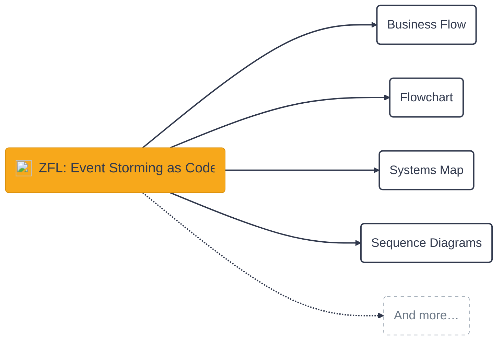
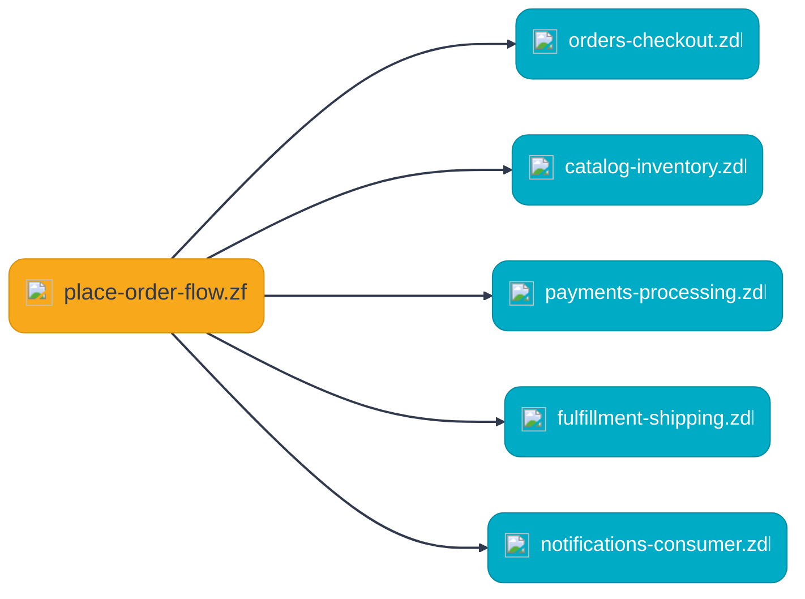
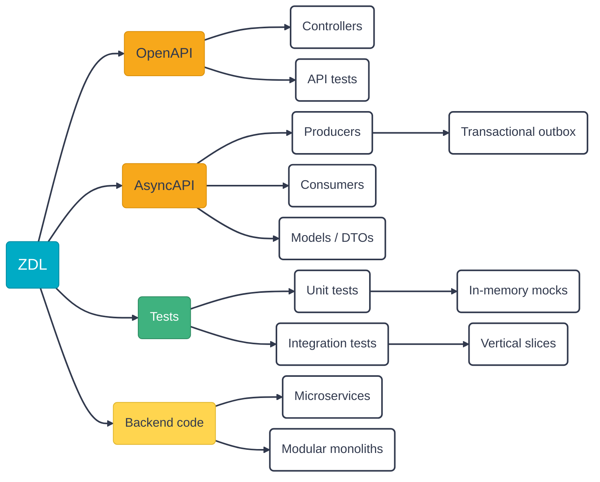

<!-- DRAFT · Human in the Loop part. "Away from Keyboard" part goes after the last slide. -->

<!-- Published JUG title -->

<p style="font-size:26px;line-height:1.2;text-align:center;margin:0">AI-Assisted Domain Driven Development</p>
<p style="font-size:34px;line-height:1.2;font-weight:700;text-align:center;margin-top:16px">From Event Storming to an Event-Driven modular monolith with Kotlin & Spring Boot</p>

---
layout: section
title: ''
---

<p style="font-size:26px;line-height:1.2;text-align:center;margin:0"><s>AI-Assisted Domain Driven Development</s></p>
<p style="font-size:34px;line-height:1.2;font-weight:700;text-align:center;margin-top:16px"><s>From Event Storming to an Event-Driven modular monolith with Kotlin and Spring Boot</s></p>


---
layout: section
title: ''
---

<p style="font-size:26px;line-height:1.2;text-align:center;margin:0">Ingeniería de Software en los tiempos que corren</p>
<p style="font-size:34px;line-height:1.2;font-weight:700;text-align:center;margin-top:16px">SDD sin quemarse las pestañas leyendo specs en Markdown escritas por LLMs</p>

---
layout: two-columns
title: 'Spec-Driven Development: Too Loops'
---

::left::

<div v-click.hide="1" style="position:absolute;left:0;right:0;top:83px;bottom:0;display:flex;align-items:center;justify-content:center">
  <h1 style="margin:0">Spec Driven Development</h1>
</div>

<div v-click="2">

### Human in the Loop

<Shot src="/two-loops-human-in-the-loop-featured.png" todo="HITL loop image" h="260px" />

DDD → models you can read and approve

</div>

::right::

<div v-click="[1, 3]">

### Away From Keyboard

<Shot src="/two-loops-afk-featured.png" todo="AFK loop image" h="260px" />

Agents implement the approved models

</div>

<!--
Two loops. AFK first: fully agentic, orchestrator + subagents, only after the human approves the models.
Then HITL: discovery + modeling (Event Storming, ZFL, ZDL), human reviews projections.
Today we focus on HITL. Everything until "Away from Keyboard" section is the HITL loop.
-->

---
layout: section
title: ''
---

# Domain Driven Design

<h1 v-click style="color:#00abc5;margin-top:8px">as code</h1>

<!-- What we do is DDD. Click: DDD as code (ZFL + ZDL). -->

---
layout: cover
title: 'Arcadia Editions'
---

<Shot src="/arcadia-editions-logo.png" todo="Arcadia Editions logo (centered)"" />

---
layout: default
title: 'Arcadia Editions @ GitHub'
---

<p style="position:absolute;right:24px;bottom:12px;font-size:20px;color:#6b7785;margin:0">github.com/arcadia-editions</p>

<div style="margin:-22px -55px 0">
<Shot src="/arcadia-editions-github-screenshot.png" todo="Screenshot: Arcadia Editions GitHub org main page" h="405px" />
</div>

---
layout: section
title: 'Arcadia Editions'
---


# Discovering the domain

---
layout: default
title: 'Three levels of Event Storming'
---

<div style="margin:-10px -55px 0">
<Shot src="/event-storming-three-levels-notebook.webp" todo="Event Storming three levels (notebook)" h="405px" />
</div>

---
layout: default
title: 'Arcadia Editions in Miro'
---

<div style="margin:20px -55px 10px">
<Shot src="/003-event-storming-arcadia-editions.jpg" todo="First Miro Event Storming" />
</div>

---
layout: default
title: 'Modeling Design Level Event Storming (2023)'
---

<div style="margin:-32px -55px -38px">
<Shot src="/EventStorming-ZDL-Mapping.png" todo="2023 image: Event Storming design level mapped to ZDL" h="455px" />
</div>

---
layout: section
title: 'Arcadia Editions'
---

# Place Order Business Flow

---
layout: default
title: 'Event Storming: Events are business Facts'
---

<div style="margin:-34px -55px -38px;height:457px;display:flex;align-items:center;justify-content:center">
<Shot src="/eventstorming-events-sequence.jpg" todo="Event Storming: Events are business Facts" h="445px" />
</div>

---
layout: default
title: 'Event Storming: Commands trigger Events'
---

<div style="margin:-34px -55px -38px;height:457px;display:flex;align-items:center;justify-content:center">
<Shot src="/eventstorming-events-commands.jpg" todo="Event Storming: Commands trigger Events" h="445px" />
</div>

---
layout: default
title: 'Event Storming: Policies are Business Rules'
---

<div style="margin:-34px -55px -38px;height:457px;display:flex;align-items:center;justify-content:center">
<Shot src="/eventstorming-events-commands-policies.jpg" todo="Event Storming: Policies are Business Rules" h="445px" />
</div>

<!-- Optional: hotspots version in public/eventstorming-events-commands-policies-hotspots.jpg -->

---
layout: section
title: 'ZFL: Event Storming as code'
---

# What is ZFL?

ZenWave Flow Language: Event Storming as code.

---
layout: default
title: 'ZFL: Building Blocks'
---

````md magic-move {lines: true}
```zfl
// 1. a business policy looks like
//      when <event> do <command>
when OrderCreated do authorizePayment {

}
```

```zfl
// 2. what a command produces: emits
when OrderCreated do authorizePayment {
    emits PaymentAuthorized
    emits PaymentDeclined
    emits PaymentFailed
}
```

```zfl
// 2b. sync calls: call + response
when StartOrderCheckout do startOrderCheckout {
    call reserveStock
    on StockReservedResult emits OrderCreated
    on StockUnavailableResult emits StockUnavailable
}

do reserveStock {
    response StockReservedResult
    response StockUnavailableResult
}
```

```zfl
// 3. outcomes: name each branch
when OrderCreated do authorizePayment {
    @outcome(authorized)
    emits PaymentAuthorized
    @outcome(declined)
    emits PaymentDeclined
    @failure @outcome(failed)
    emits PaymentFailed
}
```

```zfl
// 4. systems: who owns the command
when OrderCreated do authorizePayment {
    service PaymentsProcessing.PaymentsProcessingService
    @outcome(authorized)
    emits PaymentAuthorized
    @outcome(declined)
    emits PaymentDeclined
    @failure @outcome(failed)
    emits PaymentFailed
}
```

```zfl {3}
// 4. systems: who owns the command
when OrderCreated do authorizePayment {
    service PaymentsProcessing.PaymentsProcessingService
    @outcome(authorized)
    emits PaymentAuthorized
    @outcome(declined)
    emits PaymentDeclined
    @failure @outcome(failed)
    emits PaymentFailed
}
```
````

---
layout: default
title: 'ZFL: The systems'
---

```zfl
systems {
    @zdl("../payments-processing-api/domain-model.zdl")
    PaymentsProcessing {
        service PaymentsProcessingService {
            commands: authorizePayment, retryPayment,
                    capturePayment, voidPayment
        }
    }
    @zdl("../catalog-inventory-api/domain-model.zdl")
    CatalogInventory { ... }
}
```

---
layout: section
title: 'ZFL: EventStorming as Code'
---

# ZFL is EventStorming as Code

---
layout: default
title: 'ZFL: EventStorming as Code'
---

<div style="display:flex;justify-content:center">



</div>

---
layout: default
title: 'ZFL Projections - Event Flow'
---

<div style="margin:-34px -55px -38px;height:457px;box-sizing:border-box;padding:10px;display:flex;align-items:center;justify-content:center">
<Shot src="/zfl-eventflow-to-the-side.png" todo="ZDL: Event Flow" h="437px" />
</div>

---
layout: default
title: 'ZFL Projections - Systems'
---

<div style="margin:-34px -55px -38px;height:457px;box-sizing:border-box;padding:10px;display:flex;align-items:center;justify-content:center">
<Shot src="/zfl-systems.png" todo="ZFL Systems" h="437px" />
</div>

---
layout: default
title: 'ZFL Projections - Event Flow with System Lanes'
---

<div style="margin:-34px -55px -38px;height:457px;box-sizing:border-box;padding:10px;display:flex;align-items:center;justify-content:center">
<Shot src="/eventflow-lanes.png" todo="Event Flow with Lanes" h="437px" />
</div>

---
layout: default
title: 'ZFL Projections - Sequence Diagrams'
---

<div style="margin:-34px -55px -38px;height:457px;box-sizing:border-box;padding:10px;display:flex;align-items:center;justify-content:center">
<Shot src="/zfl-sequence-diagrams-to-the-side.png" todo="ZFL: Sequence diagrams" h="437px" />
</div>

---
layout: section
title: 'Zoom in'
---

<div class="zoom-stage">
  <div class="zoom-word">ZFL to ZDLs</div>
  <div v-click class="zoom-glass">
    
  </div>
</div>

<!-- Zoom from the business flow (ZFL) into each bounded context (ZDLs). -->

<style>
.zoom-stage { position: relative; width: 860px; height: 380px; margin: -20px auto 0; }
.zoom-word {
  position: absolute; left: 0; right: 0; top: 50%; transform: translateY(-50%);
  text-align: center; font-size: 110px; font-weight: 700; color: #31394d; white-space: nowrap;
  z-index: 1;
}
.zoom-glass {
  position: absolute; width: 380px; height: 380px; left: 442px; top: 36px;
  transform: rotate(-20deg); /* more negative = more horizontal handle */
  z-index: 0; /* behind the letters once in place */
  /* z-index flips after the 0.9s move: glass enters in front, then goes behind */
  transition: transform 0.9s cubic-bezier(.2,.8,.2,1), opacity 0.6s ease, z-index 0s linear 0.9s;
}
.zoom-glass.slidev-vclick-hidden { opacity: 0 !important; transform: translate(220px, 80px) rotate(10deg) scale(.7); z-index: 2; }
.zoom-glass img { width: 100%; height: 100%; mix-blend-mode: multiply; }
</style>

---
layout: default
title: 'One business flow: many bounded contexts'
---

<div style="display:flex;justify-content:center">



</div>

---
layout: default
title: 'ZenWave SDD skills'
---

<p style="position:absolute;right:24px;bottom:12px;font-size:20px;color:#6b7785;margin:0">github.com/ZenWave360/zenwave-sdd</p>

<div style="margin:-22px -55px 0">
<Shot src="/zenwave-sdd-github.png" todo="Screenshot: skills repo in GitHub" h="400px" />
</div>

---
layout: section
title: 'Built to last'
---

# Code is getting cheaper.

---
layout: default
title: 'Built to last'
---

# What outlives the code?

<div style="height:300px;display:flex;align-items:center;justify-content:center">
  <ul class="outlives">
    <li v-click>Data</li>
    <li v-click>APIs</li>
    <li v-click>Events</li>
  </ul>
</div>

<style>
.outlives { list-style: none; margin: 0; padding: 0; text-align: left; }
.outlives li { display: flex; align-items: center; gap: 0.4em; font-size: 54px !important; font-weight: 700; line-height: 1.1 !important; margin: 0.18em 0 !important; color: #31394d; }
/* checkbox marker: cyan box with a check */
.outlives li::before {
  content: "✓"; flex: none; width: 1.4em; height: 1.4em; box-sizing: border-box;
  border: 0.14em solid #00abc5; border-radius: 0.2em;
  display: flex; align-items: center; justify-content: center;
  font-size: 0.57em; font-weight: 900; line-height: 1; color: #00abc5;
}
</style>

<!-- Agentic coding makes code cheap. Rewrite the app in a year. Data, APIs, events must last. -->

---
layout: default
title: 'ZDL captures what lasts'
---

<div style="margin:-32px -55px -38px">
<Shot src="/EventStorming-ZDL-Mapping.png" todo="2023 image: Event Storming design level mapped to ZDL" h="455px" />
</div>

---
layout: default
title: 'ZDL captures what lasts'
class: code-sm
---

````md magic-move {lines: true}
```zfl
// Data: aggregate + state machine
@aggregate
@lifecycle(field: status, initial: CREATED)
entity Order {
    orderId String required unique
    status OrderStatus required
    totalAmount BigDecimal required
}
relationship OneToMany {
    Order{items} to OrderItem{order required}
}

enum OrderStatus { CREATED(1), CONFIRMED(2), CANCELLED(3) }
```

```zfl
// APIs: commands, REST endpoints, state transitions
@rest("/orders")
service OrdersCheckoutService for (Order) {

    @post("/start-checkout")
    @transition(to: CREATED)
    startOrderCheckout(StartOrderCheckoutInput) Order
        withEvents [OrderCreated | StockUnavailable]

    @get("/{id}")
    getOrder(id) Order?
}
```

```zfl
// Events: what we publish (AsyncAPI)
@asyncapi({ channel: "order-created-event-v1" })
event OrderCreated {
    orderId String
    customerId String
    paymentMethodId String
    amount BigDecimal
    currency String
}
```

```zfl
// Events: what we consume (AsyncAPI)
@rest("/orders")
service OrdersCheckoutService for (Order) {

    @asyncapi(api: PaymentsProcessingApi,
              channel: "payment-authorized-event-v1")
    @transition(from: CREATED, to: CONFIRMED)
    confirmOrder(ConfirmOrderInput) Order  withEvents OrderConfirmed
}
```

```zfl {5-6}
// Events: what we consume (AsyncAPI)
@rest("/orders")
service OrdersCheckoutService for (Order) {

    @asyncapi(api: PaymentsProcessingApi,
              channel: "payment-authorized-event-v1")
    @transition(from: CREATED, to: CONFIRMED)
    confirmOrder(ConfirmOrderInput) Order  withEvents OrderConfirmed
}
```
````

<!-- Source: orders-checkout-api/domain-model.zdl (trimmed). Data + state machine, APIs, events. -->

---
layout: section
title: 'Connected Graph'
---

# A connected graph

ZFL + ZDLs, deterministically parseable.

---
layout: default
title: 'Connected Graph'
---

<MetroMap />

<p style="margin-top:6px;font-size:24px;font-weight:700;text-align:center">Models become a connected graph.</p>

---
layout: default
title: 'Connected Graph: the parser'
hide: true
---

<div style="margin:-34px -55px -38px;height:457px;box-sizing:border-box;padding:10px 0;display:flex;align-items:center;justify-content:center">
<Shot src="/zenwave-architecture-github.png" todo="Screenshot: deterministic parser library (architecture repo on GitHub)" h="437px" />
</div>

---
layout: default
title: 'Connected Graph: Event Catalog'
---

<div style="margin:-34px -55px -38px;height:457px;box-sizing:border-box;padding:10px 0;display:flex;align-items:center;justify-content:center">
<Shot src="/eventcatalog-screenshot-light.png" todo="Screenshot: Event Catalog generated from ZFL + ZDLs" h="437px" />
</div>


---
layout: default
title: 'LLMs reason on the graph too'
clicks: 5
---

<p style="margin:-10px 0 14px;font-size:26px;font-weight:700;text-align:center">“What happens to the stock if the payment is declined?”</p>

<GraphTrace :step="$clicks" />

<p v-click="5" style="margin-top:10px;font-size:22px;text-align:center;color:#31394d">
Stock is released <span style="color:#6b7785">(compensates reserveStock)</span> and the order is cancelled.
</p>

<!-- Option 1. No parser: the agent follows the links. Click by click: authorize → declined → releaseStock → StockReleased/cancelOrder → OrderCancelled. -->


---
layout: default
title: 'Connected graph · agents'
hide: true
---

# LLMs reason on the graph too

No library needed: agents read ZFL + ZDLs and follow the links.

---
layout: default
title: 'Towards formal verification'
---

# Towards formal verification?

<div style="height:300px;display:flex;align-items:center;justify-content:center">
  <ul class="tbd">
    <li v-click>ZFL links the state machines of each ZDL into one flow</li>
    <li v-click>Every action has its compensation</li>
    <li v-click>Each ZDL state machine is valid by itself</li>
    <li v-click>With discipline → verifiable business flows</li>
  </ul>
</div>

<!-- Pointer only, not a promise. Building blocks are in ZFL; needs discipline. Orange = not green yet, not red: still to be proven. -->

<style>
.tbd { list-style: none; margin: 0; padding: 0; text-align: left; }
.tbd li { display: flex; align-items: center; gap: 0.6em; font-size: 30px !important; font-weight: 700; line-height: 1.2 !important; margin: 0.35em 0 !important; color: #31394d; }
/* orange checkbox: checks we need to pass; not green yet, not red either */
.tbd li::before {
  content: "✓"; flex: none; width: 1.3em; height: 1.3em; box-sizing: border-box;
  border: 0.12em solid #f7a81b; border-radius: 0.2em;
  display: flex; align-items: center; justify-content: center;
  font-size: 0.85em; font-weight: 900; line-height: 1; color: #f7a81b;
}
</style>

---
layout: two-columns
title: 'Formal verification with TLA+'
class: code-tla
---

::left::

```tla
---- MODULE PlaceOrder ----
EXTENDS Naturals
VARIABLES order, stock, payment
vars == <<order, stock, payment>>

Init ==
  /\ order   = "CREATED"
  /\ stock   = "RESERVED"
  /\ payment = "PENDING"

Authorize ==
  /\ payment  = "PENDING"
  /\ payment' = "AUTHORIZED"
  /\ UNCHANGED <<order, stock>>

Decline ==
  /\ payment  = "PENDING"
  /\ payment' = "DECLINED"
  /\ UNCHANGED <<order, stock>>
```

::right::

```tla
ReleaseStock ==   \* compensates reserveStock
  /\ payment = "DECLINED"
  /\ stock   = "RESERVED"
  /\ stock'  = "RELEASED"
  /\ UNCHANGED <<order, payment>>

CancelOrder ==
  /\ stock  = "RELEASED"
  /\ order  = "CREATED"
  /\ order' = "CANCELLED"
  /\ UNCHANGED <<stock, payment>>

Next == Authorize \/ Decline
          \/ ReleaseStock \/ CancelOrder
Spec == Init /\ [][Next]_vars /\ WF_vars(Next)

\* a declined payment never leaks stock
NoLeak == (payment = "DECLINED")
            ~> (stock = "RELEASED" /\ order = "CANCELLED")
===========================
```

<div v-click class="tla-verdict">ZFL is not 100% of TLA+ … but humans can read it.</div>

<!-- TLA+ = the real thing for formal verification, but nobody on the team reads this. ZFL + ZDL: not 100% of what TLA+ checks, but user friendly. Same flow as the ZFL "when PaymentDeclined do releaseStock" lines. -->

<style>
.code-tla { --slidev-code-font-size: 13px; --slidev-code-line-height: 1.3; }
.tla-verdict {
  position: absolute; left: 55px; right: 55px; bottom: 18px; padding: 10px 16px;
  background: #fff; border-left: 6px solid #f7a81b; box-shadow: 0 4px 14px rgba(49,57,77,.18);
  font-size: 24px; font-weight: 700; color: #31394d;
}
</style>

---
layout: default
title: 'Deterministic generation'
---

<div style="margin:-34px -55px -38px;height:457px;box-sizing:border-box;padding:10px 0;display:flex;align-items:center;justify-content:center">
<Shot src="/zenwave-website-light.png" todo="Screenshot: ZenWave website" h="437px" />
</div>

<!-- Flashback: ZenWave -->

---
layout: default
title: 'Generation: Many artifacts, not one shot'
---

<div style="margin:-34px -55px -38px;height:457px;box-sizing:border-box;padding:10px 0;display:flex;align-items:center;justify-content:center">
<Shot src="/SDK-MindMap.light.png" todo="ZenWave SDK mind map" h="437px" />
</div>

<!-- From the same models: many generated artifacts, repeatable. -->

---
layout: default
title: 'Generation: Many artifacts, not one shot'
---

<div style="display:flex;justify-content:center;margin-top:-18px">



</div>

<!-- API-first: contracts (OpenAPI, AsyncAPI) first, then code and tests. Integration tests validate each vertical slice. -->

---
layout: default
title: 'Default architecture: Clean Hexagonal'
---

<div style="margin:-34px -55px -38px;height:457px;box-sizing:border-box;padding:10px 0;display:flex;align-items:center;justify-content:center">
<Shot src="/SDK-ServiceImplementation-Hexagonal.light.png" todo="ZenWave SDK default Clean Hexagonal architecture" h="437px" />
</div>

---
layout: default
title: 'Deterministic Generation: Many Architectures'
class: code-sm
---

````md magic-move {lines: false}
```zfl
config {
    basePackage "com.arcadiaeditions.orders"
    layout CleanHexagonalProjectLayout
}

// generated packages
├─ core.domain                  // Order, OrderStatus
├─ core.inbound                 // OrdersCheckoutService
├─ core.outbound.jpa            // OrderRepository
├─ core.application             // OrdersCheckoutServiceImpl
├─ adapters.web                 // REST controllers
└─ adapters.events              // event listeners
```

```zfl
config {
    basePackage "com.arcadiaeditions.orders"
    layout LayeredProjectLayout
}

// generated packages
├─ domain                       // Order, OrderStatus
├─ service                      // OrdersCheckoutService
├─ repository.jpa               // OrderRepository
├─ service.impl                 // OrdersCheckoutServiceImpl
├─ web                          // REST controllers
└─ events                       // event listeners
```

```zfl
config {
    basePackage "com.arcadiaeditions.orders"
    layout SimpleDomainProjectLayout
}

// generated packages
├─ domain                       // Order, OrderStatus
├─ .                            // OrdersCheckoutService
├─ .                            // OrderRepository
├─ .                            // OrdersCheckoutServiceImpl
├─ .                            // REST controllers
└─ .                            // event listeners
```

```zfl
config {
    basePackage "com.arcadiaeditions.orders"
    layout HexagonalProjectLayout
}

// generated packages
├─ domain                       // Order, OrderStatus
├─ application.port.driving     // OrdersCheckoutService
├─ application.port.driven.jpa  // OrderRepository
├─ application.service          // OrdersCheckoutServiceImpl
├─ adapter.driving.web          // REST controllers
└─ adapter.driving.event        // event listeners
```

```zfl
config {
    basePackage "com.arcadiaeditions.orders"
    layout CleanArchitectureProjectLayout
}

// generated packages
├─ domain                       // Order, OrderStatus
├─ usecase.boundary.input       // OrdersCheckoutService
├─ usecase.boundary.output.jpa  // OrderRepository
├─ usecase.interactor           // OrdersCheckoutServiceImpl
├─ adapter.controller           // REST controllers
└─ adapter.listener             // event listeners
```
````

<!-- Same ZDL, five project layouts. Change one line, regenerate. Packages from zenwave-sdk ProjectLayout classes; "." = base package. Fully customizable: layout.xxxPackage or your own ProjectLayout. -->

---
layout: section
title: 'Away from Keyboard'
---

# Away from Keyboard

---
layout: default
title: 'SDD: the second loop'
---

<div style="margin:-34px -55px -38px;height:457px;box-sizing:border-box;padding:10px 0;display:flex;align-items:center;justify-content:center">
<Shot src="/two-loops-afk-featured.png" todo="AFK loop image" h="437px" />
</div>

<!-- Back to the two loops: we leave Human in the Loop and enter the Away From Keyboard loop. TODO: next part -->

---
layout: default
title: 'ZenWave SDD skills'
---

<p style="position:absolute;right:24px;bottom:12px;font-size:20px;color:#6b7785;margin:0">github.com/ZenWave360/zenwave-sdd</p>

<div style="margin:-22px -55px 0">
<Shot src="/iterative-model-driven-light.png" todo="Iterative model-driven workflow" h="400px" />
</div>

<!-- zenwave-sdd: iterative model-driven workflow. -->
