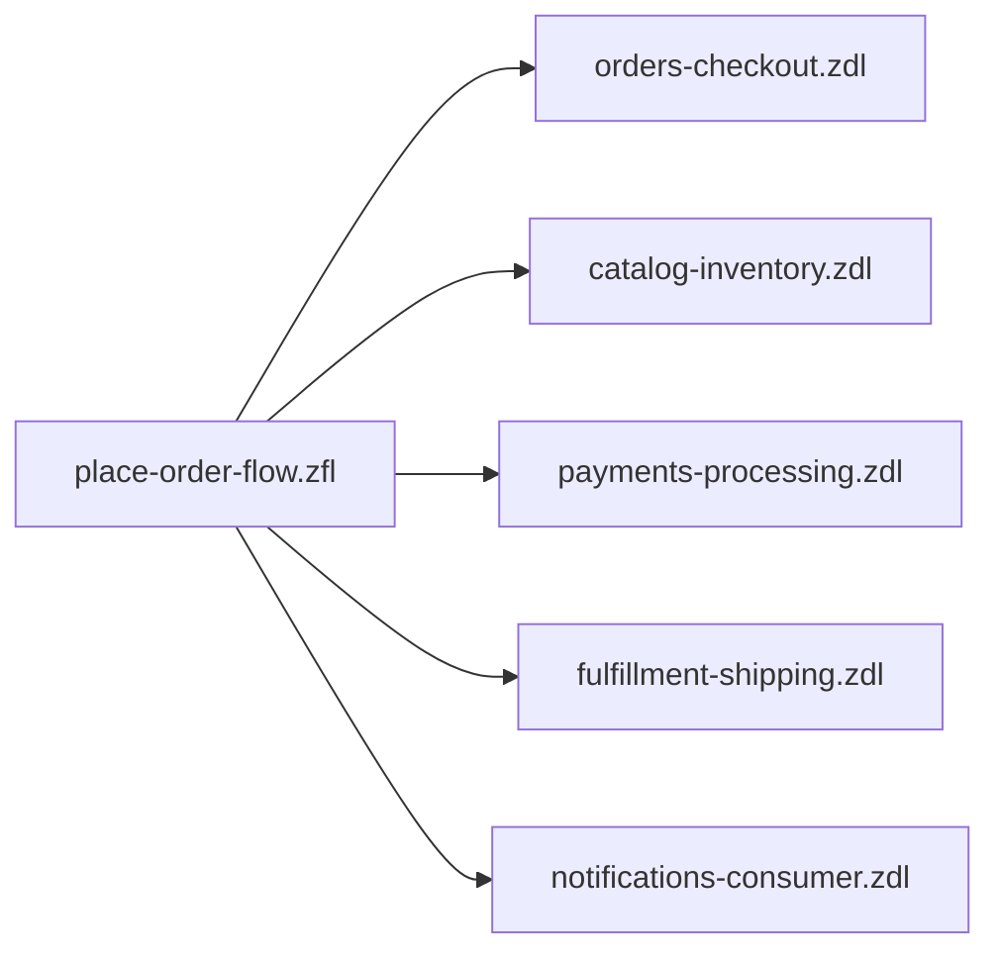
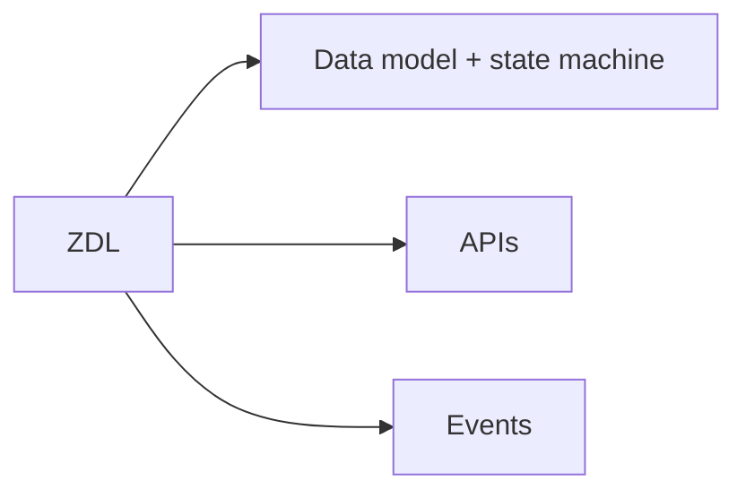
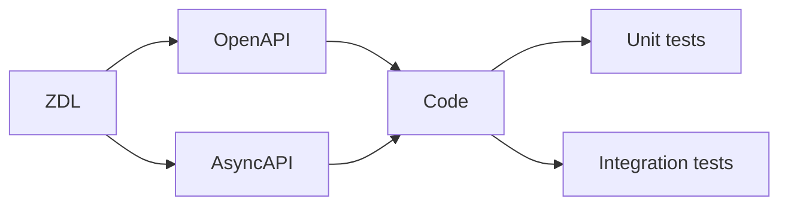

<!-- DRAFT · Human in the Loop part. "Away from Keyboard" part goes after the last slide. -->

<!-- Published JUG title -->

<h1 style="font-size:38px;line-height:1.2;text-align:center;margin:0">AI-Assisted Domain Driven Development</h1>
<p style="font-size:22px;text-align:center;margin-top:16px">From Event Storming to an Event-Driven modular monolith with Kotlin and Spring Boot</p>

---
layout: section
title: 'Arcadia Editions & ZenWave'
---

<h1 style="font-size:38px;line-height:1.2;text-align:center;margin:0"><s>AI-Assisted Domain Driven Development</s></h1>
<p style="font-size:22px;text-align:center;margin-top:16px"><s>From Event Storming to an Event-Driven modular monolith with Kotlin and Spring Boot</s></p>

---
layout: section
title: 'Arcadia Editions & ZenWave'
---

<h1 style="font-size:38px;line-height:1.2;text-align:center;margin:0">Ingeniería de Software en los tiempos que corren</h1>
<p style="font-size:22px;text-align:center;margin-top:16px">Cómo hacer SDD y no quemarse las pestañas leyendo specs en Markdown escritas por LLMs</p>

---
layout: cover
title: 'Arcadia Editions'
---

<Shot src="/arcadia-editions-logo.png" todo="Arcadia Editions logo (centered)" h="300px" />

---
layout: default
title: 'Arcadia Editions'
---

# github.com/arcadia-editions

<Shot src="/arcadia-editions-logo.png" todo="Screenshot: Arcadia Editions GitHub org main page" />

---
layout: default
title: 'Arcadia Editions'
---

# Where it started: Event Storming in Miro

<Shot src="/003-event-storming-arcadia-editions.jpg" todo="First Miro Event Storming" />

---
layout: default
title: 'Flashback · 2023'
---

# ZDL: from Event Storming to a model

Design-level Event Storming → aggregates, commands, events.

<Shot src="/zdl-2023-flashback.png" todo="2023 image: Event Storming design level mapped to ZDL" />

<!-- 2023 image. Was made to explain ZDL maps design-level ES: aggregates, commands, events. -->

---
layout: section
title: 'Event Storming'
---

# Event Storming · place order

---
layout: default
title: 'Event Storming · 1 · Events'
---

<Shot src="/eventstorming-events-sequence.jpg" todo="ES phase 1: events" h="420px" />

---
layout: default
title: 'Event Storming · 2 · Commands + Events'
---

<Shot src="/eventstorming-events-commands.jpg" todo="ES phase 2: commands and events" h="420px" />

---
layout: default
title: 'Event Storming · 3 · Policies'
---

<Shot src="/eventstorming-events-commands-policies.jpg" todo="ES phase 3: policies" h="420px" />

<!-- Optional: hotspots version in public/eventstorming-events-commands-policies-hotspots.jpg -->

---
layout: section
title: 'ZFL'
---

# What is ZFL?

ZenWave Flow Language: Event Storming as code.

---
layout: default
title: 'ZFL · building blocks'
---

````md magic-move {lines: true}
```zfl
// 1. when <event> do <command>
when OrderCreated do authorizePayment {

}
```

```zfl
// 2. what a command produces: emits
when OrderCreated do authorizePayment {
    emits PaymentAuthorized
    emits PaymentDeclined
    emits PaymentFailed
}
```

```zfl
// 2b. sync calls: call + response
when StartOrderCheckout do startOrderCheckout {
    call reserveStock
    on StockReservedResult emits OrderCreated
    on StockUnavailableResult emits StockUnavailable
}

do reserveStock {
    response StockReservedResult
    response StockUnavailableResult
}
```

```zfl
// 3. outcomes: name each branch
when OrderCreated do authorizePayment {
    @outcome(authorized)
    emits PaymentAuthorized
    @outcome(declined)
    emits PaymentDeclined
    @failure @outcome(failed)
    emits PaymentFailed
}
```

```zfl
// 4. systems: who owns the command
when OrderCreated do authorizePayment {
    service PaymentsProcessing.PaymentsProcessingService
    @outcome(authorized)
    emits PaymentAuthorized
    @outcome(declined)
    emits PaymentDeclined
    @failure @outcome(failed)
    emits PaymentFailed
}
```
````

---
layout: default
title: 'ZFL · systems'
---

```zfl
systems {
    @zdl("payments-processing-api/domain-model.zdl")
    PaymentsProcessing {
        service PaymentsProcessingService {
            commands: authorizePayment, retryPayment, capturePayment, voidPayment
        }
    }
    @zdl("catalog-inventory-api/domain-model.zdl")
    CatalogInventory { ... }
}
```

Each system points to its ZDL.

---
layout: section
title: 'ZFL Projections'
---

# ZFL Projections

---
layout: two-columns
title: 'ZFL Projections · 1'
---

::left::

<Shot src="/proj-zfl-source.png" todo="ZFL source" />

::right::

<Shot src="/proj-event-flow.png" todo="Event Flow" />

---
layout: default
title: 'ZFL Projections · 2 · Event Flow'
---

<Shot src="/proj-event-flow.png" todo="Event Flow (big)" h="440px" />

---
layout: default
title: 'ZFL Projections · 3 · Systems'
---

<Shot src="/eventstorming-systems.png" todo="Event Flow systems (big)" h="440px" />

---
layout: default
title: 'ZFL Projections · 4 · Sequence'
---

<Shot src="/proj-sequence-diagrams.png" todo="Sequence diagrams" h="440px" />

---
layout: section
title: 'Zoom in'
---

# Zoom: ZFL → ZDLs

---
layout: default
title: 'One flow, many models'
---



---
layout: default
title: 'ZenWave SDD skills'
---

<Shot src="/skills-bitbucket.png" todo="Screenshot: skills repo in Bitbucket" h="380px" />

<!-- TODO: Bitbucket repo URL -->
[TODO: link to skills repo](https://bitbucket.org/)

---
layout: section
title: 'Built to last'
---

# Code is cheap. Use and throw away.

---
layout: default
title: 'Built to last'
---

# What outlives the code?

<v-clicks>

- **Data**
- **APIs**
- **Events**

</v-clicks>

<!-- Agentic coding makes code cheap. Rewrite the app in a year. Data, APIs, events must last. -->

---
layout: default
title: 'ZDL captures what lasts'
---



---
layout: section
title: 'Connected graph'
---

# A connected graph

ZFL + ZDLs, deterministically parseable.

---
layout: default
title: 'Connected graph · Event Catalog'
---

<Shot src="/event-catalog.png" todo="Screenshot: Event Catalog generated from ZFL + ZDLs" h="420px" />

<!-- Live demo: open Event Catalog, show it is generated from the models. -->

---
layout: default
title: 'Connected graph · parser'
---

<Shot src="/architecture-parser.png" todo="Screenshot: deterministic parser library (architecture repo on GitHub)" h="420px" />

---
layout: default
title: 'Connected graph · agents'
---

# LLMs reason on the graph too

No library needed: agents read ZFL + ZDLs and follow the links.

---
layout: default
title: 'Connected graph · towards formal verification'
---

# Towards formal verification?

<v-clicks>

- ZFL links the state machines of each ZDL into one flow
- Every action has its compensation
- Each ZDL state machine is valid by itself
- With discipline → verifiable business flows

</v-clicks>

<!-- Pointer only, not a promise. Building blocks are in ZFL; needs discipline. -->

---
layout: section
title: 'Deterministic generation'
---

# Flashback: ZenWave

<Shot src="/zenwave-website.png" todo="Screenshot: ZenWave website" h="300px" />

---
layout: default
title: 'Deterministic generation · 1'
---

# Many artifacts, not one shot

From the same models: many generated artifacts, repeatable.

---
layout: default
title: 'Deterministic generation · 2'
---

# Many architectures

Choose how to generate. Everything customizable.

---
layout: default
title: 'Deterministic generation · 3'
---

# API-first, event-driven



Tests validate each vertical slice.

---
layout: section
title: 'Away from Keyboard'
---

# Away from Keyboard

<!-- TODO: next part -->
