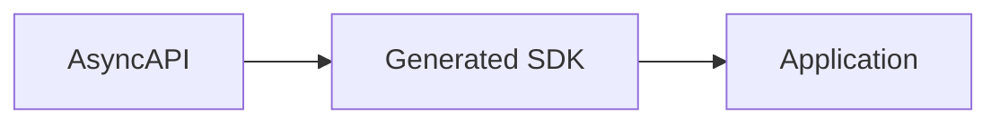

# Stop API Drift: Generate Java from AsyncAPI

---
layout: cover
title: 'Stop API Drift: Provision Kafka From AsyncAPI'
---

# Stop API Drift: Provision Kafka From AsyncAPI

---
layout: default
title: 'Stop API Drift: Generate Java from AsyncAPI'
---

# What is API drift?

API drift is the progressive divergence between the declared API contract and the system that implements it.

---
layout: section
title: 'Stop API Drift: Generate Java from AsyncAPI'
---

# Two faces of API drift

---
layout: two-columns
title: 'Stop API Drift: Generate Java from AsyncAPI'
---

::left::

## Application

- Schemas and headers
- Operations and behavior

::right::

## Platform

- Topics and partitions
- Retention and compatibility

---
layout: image-heavy
title: 'Stop API Drift: Generate Java from AsyncAPI'
---

::text::

## AsyncAPI mark

Images can sit beside short explanatory text without changing the shared header.

::image::


---
layout: default
title: 'Stop API Drift: Generate Java from AsyncAPI'
---

# One source of truth



---
layout: default
title: 'Stop API Drift: Generate Java from AsyncAPI'
---

# Build example

```bash
npm run build:theme-showcase
npm run export:theme-showcase
```

---
layout: outro
title: 'Stop API Drift: Generate Java from AsyncAPI'
---

# Questions?
